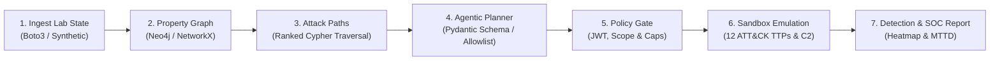

# Project Falcon Strike-AI

**Agentic AI Automated Red Teaming & Continuous Threat Exposure Management (CTEM) Engine**  
*Internal // Confidential — CrowdStrike Adversary Emulation Engineering*

---

## 1. Overview & Vision

Modern enterprises operate in highly dynamic cloud environments where identity is the primary attack surface. Attack paths mutate by the hour through routine infrastructure changes, while detections decay silently over time. 

**Falcon Strike-AI** is an autonomous breach-and-attack simulation engine designed to close this gap. It continuously maps cloud identity and exposure posture into a property graph, computes high-risk attack paths from exposed footholds to crown jewels, tasks a constrained AI agent to assemble safe multi-stage campaigns from a vetted ATT&CK library, emulates observable adversary signals inside isolated ephemeral sandboxes, and correlates ground-truth indicators against security controls to produce actionable SOC reports with measured Mean Time to Detect (MTTD).

---

## 2. Core Safety Guardrails (Non-Negotiable)

Falcon Strike-AI is an authorized security assurance tool. All offensive capabilities are strictly **emulation-only**:
- **Dry-Run by Default**: Default execution touches zero cloud resources (`FALCON_DRY_RUN=true`).
- **Compiled Account Allowlist**: The engine refuses to run against any AWS account not present on the compiled allowlist (`NFR-S1`).
- **Mandatory Authorization Token**: Exiting dry-run mode requires a signed, time-boxed JWT authorization token signed by an authorized lead (`NFR-S2`).
- **Zero Weaponized Exploits**: Emulation is purely behavioural and uses inert marker tokens; no live exploits or destructive actions are ever executed.
- **Emergency Kill Switch**: A single signal/command aborts execution within seconds and triggers immediate baseline rollback (`NFR-S3`).
- **Verified Idempotent Teardown**: Pre-run state baselines are recorded; every temporary artifact is guaranteed removed and verified (`NFR-S7`).
- **Tamper-Evident Audit Chain**: Every action is cryptographically hash-chained in an append-only JSONL log (`NFR-A2`).

---

## 3. High-Level Architecture & Workflow

The platform operates across a 7-stage closed-loop pipeline:



---

## 4. Repository Structure

```
FalconStrikeAI/
├── backend/
│   ├── app/
│   │   ├── api/            # FastAPI control plane routes (/health, /api/v1)
│   │   ├── core/           # Configuration, logging, security & exceptions
│   │   ├── collectors/     # Cloud environment asset ingestion
│   │   ├── graph/          # Property graph schema, Neo4j & path analysis
│   │   ├── planner/        # LLM agent loop & Pydantic campaign schemas
│   │   ├── policies/       # Policy gate, allowlist & blast-radius checks
│   │   ├── techniques/     # Curated 12 MITRE ATT&CK emulation modules
│   │   ├── orchestrator/   # Sandbox execution, C2 beacon sink & teardown
│   │   ├── telemetry/      # OpenTelemetry & hash-chained audit logger
│   │   ├── detection/      # SIEM correlation & detection stub engine
│   │   └── reporting/      # SOC report generator (HTML/Markdown/JSON)
│   └── tests/              # Comprehensive test suites (unit, security, e2e)
├── configs/                # Environment and detection rule configurations
├── policies/               # OPA/Rego and declarative guardrail definitions
├── docs/                   # Full architectural, requirements & audit docs
│   ├── PRD_ANALYSIS.md
│   ├── ENVIRONMENT_AUDIT.md
│   ├── IMPLEMENTATION_GAPS.md
│   ├── ARCHITECTURE.md
│   ├── IMPLEMENTATION_PLAN.md
│   ├── REQUIREMENT_TRACEABILITY.md
│   ├── RISK_REGISTER.md
│   └── TEST_AND_EVIDENCE_PLAN.md
├── scripts/                # Helper utilities and benchmark execution scripts
├── artifacts/              # Audit logs, generated reports, and evidence
├── .env.example            # Environment configuration template
├── .gitignore              # Git ignore rules
├── pyproject.toml          # Python project specification & tool settings
└── README.md               # Project documentation and guide
```

---

## 5. Getting Started & Verification

### 5.1 Prerequisites
- Python 3.11+ (Python 3.14 recommended and fully tested)
- Git 2.40+
- (Optional) Docker Desktop & Neo4j 5+ (in-memory fallbacks provided for offline testing)

### 5.2 Environment Configuration
Copy the configuration template to `.env`:
```bash
cp .env.example .env
```

### 5.3 Executing the End-to-End Pipeline (CLI)
Run the complete 17-stage CTEM pipeline in dry-run mode:
```bash
python -m backend.app.main run --mode synthetic --dry-run
```

### 5.4 Running the Test Suite & Coverage
Execute the complete test suite with coverage report:
```bash
python -m pytest backend/tests -v --cov=backend/app
```

### 5.5 Starting the Control Plane API
Launch the FastAPI control server:
```bash
python -m uvicorn backend.app.main:app --host 127.0.0.1 --port 8000
```
Then visit:
- Health Endpoint: `http://127.0.0.1:8000/health`
- OpenAPI Documentation: `http://127.0.0.1:8000/docs`

---

## 6. Five-Day Delivery Roadmap (Nov 1 – Nov 6, 2026)

| Milestone | Target Scope | Status |
| :--- | :--- | :--- |
| **Day 1 (Nov 1)** | PRD Analysis, Architecture Docs, Repo Foundation, Health API | **COMPLETE** |
| **Day 2 (Nov 2)** | AWS Cloud Ingestion, Property Graph Modeling, Path Finder & Scale Benchmark | **COMPLETE** |
| **Day 3 (Nov 3)** | Autonomous LLM Campaign Planner, Technique Library & Safety Policy Gate | **COMPLETE** |
| **Day 4 (Nov 4)** | Safe Sandbox Execution, Benign C2 Signalling, Telemetry & Verified Teardown | **COMPLETE** |
| **Day 5 (Nov 5)** | Detection Correlation, Hash-Chained Audit, SOC Reporting & End-to-End Integration | **COMPLETE** |
| **Day 6 (Nov 6)** | Final End-to-End Submission Sign-Off & Packaging | Ready for Review |

---

## 7. Key Architecture & Technical Documents

- [`docs/PRD_ANALYSIS.md`](docs/PRD_ANALYSIS.md): Comprehensive functional & non-functional PRD requirements analysis.
- [`docs/ARCHITECTURE.md`](docs/ARCHITECTURE.md): System architecture and high-level design specification.
- [`docs/REQUIREMENT_TRACEABILITY.md`](docs/REQUIREMENT_TRACEABILITY.md): Full Requirements Traceability Matrix (RTM).
- [`docs/DETECTION_CORRELATION.md`](docs/DETECTION_CORRELATION.md): Detection correlation engine, SIEM adapters, and MTTD math.
- [`docs/AUDIT_INTEGRITY.md`](docs/AUDIT_INTEGRITY.md): Tamper-evident hash-chained audit logging and verification.
- [`docs/SOC_REPORTING.md`](docs/SOC_REPORTING.md): Multi-format executive reporting, ATT&CK heatmaps, and remediations.
- [`docs/END_TO_END_RUNBOOK.md`](docs/END_TO_END_RUNBOOK.md): Step-by-step operator runbook for CLI and REST API.
- [`docs/SECURITY_REVIEW.md`](docs/SECURITY_REVIEW.md): In-depth 10-layer security architecture and threat review.
- [`docs/DAY_5_IMPLEMENTATION_REPORT.md`](docs/DAY_5_IMPLEMENTATION_REPORT.md): Day 5 implementation closing report.

