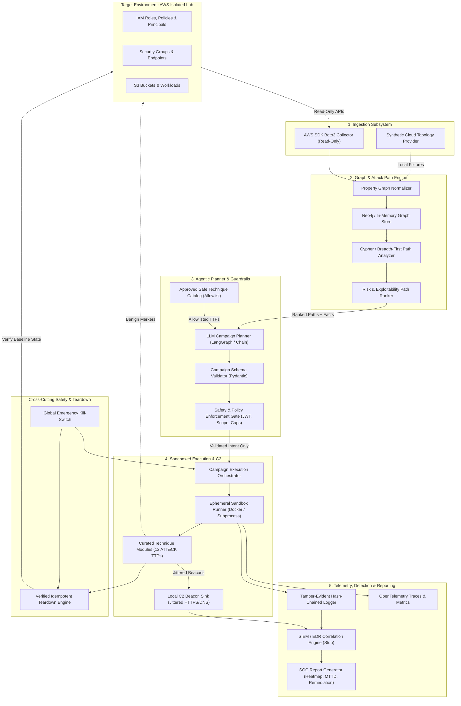

# Falcon Strike-AI — System Architecture & High-Level Design

**Document Version:** 1.0.0  
**Date:** 2026-11-01  
**Project:** Falcon Strike-AI (Adversary Emulation & CTEM Engine)  
**Security Classification:** Strictly Authorized Lab Use Only  

---

## 1. System Overview & Core Philosophy

Falcon Strike-AI is an autonomous cloud adversary emulation and Continuous Threat Exposure Management (CTEM) platform designed to safely validate defensive detections without risking live infrastructure or data. The engine operates on four fundamental engineering axioms:

1. **Strictly Non-Destructive**: The platform emulates observable behavioural signals (API patterns, process metadata, benign network beacons); it never executes live exploit payloads, weaponized vulnerabilities, or destructive operations.
2. **Hardcoded Safety Boundaries**: Safety is enforced in code, not guidelines. Compiled account allowlists, cryptographic authorization tokens, hard blast-radius caps, and kill-switches run ahead of all execution logic.
3. **Separation of Intelligence & Execution**: The AI agent (LLM planner) reasons over structured graph data and emits typed, schema-validated intent (JSON). The model possesses zero shell or direct API execution capabilities.
4. **Provable Auditability & Reversibility**: Every action is cryptographically hash-chained in an append-only audit log before and after execution. Every resource touched is registered for verified, idempotent teardown back to baseline.

---

## 2. End-to-End Architectural Flow

The diagram below illustrates the complete 7-stage pipeline, the security boundaries, and the cross-cutting policy and audit wrappers:

---

## 3. Subsystem Breakdown & Component Responsibilities

### 3.1 Subsystem 1: Environment Ingestion & Asset Collection
- **Responsibilities:**
  - Enumerate IAM users, groups, roles, managed policies, inline policies, and trust relationships via read-only APIs (`iam:Get*`, `iam:List*`).
  - Enumerate network exposure: EC2 security groups, inbound rules (`0.0.0.0/0`), public IP attachments, and S3 public access block configurations.
  - Discover compute-to-identity bindings (e.g. EC2 instance profiles linked to IAM roles).
  - Provide a synthetic topology fixture loader when AWS credentials are absent.
- **Boundaries & Security:** 
  - Read-only AWS IAM permissions exclusively. Zero write/mutate permissions granted to collectors.
  - Pre-flight account check: Ingestion refuses to connect to any account not listed in `FALCON_ALLOWLISTED_ACCOUNTS`.

### 3.2 Subsystem 2: Property Graph & Attack Path Engine
- **Responsibilities:**
  - Transform raw AWS/synthetic asset metadata into a canonical property graph schema:
    - **Nodes:** `Account`, `Principal`, `Role`, `Policy`, `EC2Instance`, `S3Bucket`, `PublicEndpoint`.
    - **Edges:** `CAN_ASSUME`, `HAS_PERMISSION`, `TRUSTS`, `EXPOSES`, `BOUND_TO`, `MEMBER_OF`.
  - Misconfiguration enrichment: Detect wildcard permissions (`"Action": "*"`), known cloud privilege escalation primitives (e.g., `iam:PassRole` + `ec2:RunInstances`), and unauthenticated S3 access.
  - Path traversal: Execute Cypher path-finding queries finding reachable chains from `PublicEndpoint` to `AdminRole` or `SensitiveDataStore`.
  - Path ranking: Score paths based on length, required privileges, and asset criticality.
- **Performance Requirement:** Sub-second p95 path traversal at 10,000+ nodes using indexed label queries.

### 3.3 Subsystem 3: Autonomous Campaign Planner & Policy Gate
- **Responsibilities:**
  - Consume top-ranked attack path and lab context.
  - Formulate an ordered multi-stage attack campaign mapped across ATT&CK tactics (Initial Access → Discovery → Privilege Escalation → Persistence → Credential Access → C2 → Exfiltration).
  - Restrict technique selection exclusively to the registered 12 ATT&CK technique catalog.
  - Emit typed JSON strictly validated against Pydantic models.
- **Safety & Policy Gate (Cross-Cutting Invariant):**
  - **Account Allowlist Check:** Re-verifies targeted account against compiled allowlist.
  - **Authorization Token Check:** Validates HMAC-SHA256 / RSA-signed JWT token specifying authorized operator, target account, and expiration timestamp.
  - **Destructiveness Check:** Disallows any destructive, modifying, or non-reversible actions.
  - **Blast-Radius Check:** Ensures campaign does not exceed resource touch caps (default max 5 resources per campaign).

### 3.4 Subsystem 4: Ephemeral Sandbox Execution & C2 Signalling
- **Responsibilities:**
  - Spawn isolated, ephemeral execution contexts (Docker container runner or sandboxed subprocess runner).
  - Execute vetted Python emulation modules matching the planned ATT&CK techniques.
  - Generate realistic C2 beacon traffic: Periodic HTTPS callbacks with configurable interval (default 5s) and randomized jitter (±20%), and DNS lookups carrying inert base64 tokens terminating at local lab sinks.
  - Maintain a pre-execution state registry for every resource created or modified.
- **Boundaries:**
  - Network egress restricted to local mock sink / lab-owned endpoints.
  - Inert markers only: Files contain explicit banners (e.g., `FALCON_STRIKE_BENIGN_MARKER_<UUID>`).

### 3.5 Subsystem 5: Telemetry, Detection Correlation & Reporting
- **Responsibilities:**
  - Emit OpenTelemetry traces and structured audit events for every technique execution.
  - Maintain an append-only, tamper-evident hash-chained audit log file (`sha256(prev_hash + entry)`).
  - Correlate emitted ground-truth IOCs (IPs, hashes, user-agents, API calls) against detections captured in the Detection Stub.
  - Calculate per-technique status (`DETECTED`, `MISSED`, `PARTIAL`) and Mean Time to Detect (MTTD).
  - Produce executive and technical SOC detection validation reports in Markdown, JSON, and visual HTML.

### 3.6 Subsystem 6: Verification & Teardown
- **Responsibilities:**
  - Post-campaign or upon kill-switch activation, iterate through the cleanup stack in reverse order.
  - Revert all benign test principals, temporary policy attachments, or marker files.
  - Verify that the final environment state matches the pre-run baseline.
  - Log verified teardown evidence to the audit log.

---

## 4. API & Interface Specifications

### 4.1 Internal API Contracts
All components interact via typed Python protocols and Pydantic models:
1. `CollectorProtocol` → returns `CloudEnvironmentState`
2. `GraphStoreProtocol` → accepts `CloudEnvironmentState`, returns `List[RankedAttackPath]`
3. `PlannerProtocol` → accepts `RankedAttackPath` + `EnvFacts`, returns `CampaignPlan`
4. `PolicyGateProtocol` → accepts `CampaignPlan` + `AuthContext`, returns `PolicyDecision`
5. `OrchestratorProtocol` → accepts approved `CampaignPlan`, returns `ExecutionSummary`
6. `DetectionEngineProtocol` → accepts `GroundTruthIOCs`, returns `DetectionScorecard`
7. `ReportGeneratorProtocol` → accepts `DetectionScorecard`, exports reports.

### 4.2 REST Control API (FastAPI)
The engine provides an HTTP control interface mounted under `/api/v1`:
- `GET /health` — System status, dependency health, and mode (dry-run vs. live).
- `POST /api/v1/collectors/run` — Trigger cloud asset ingestion (synthetic or live AWS).
- `GET /api/v1/graph/stats` — Retrieve property graph statistics and node counts.
- `GET /api/v1/attack-paths` — Discover and rank computed attack paths.
- `POST /api/v1/planner/plan` — Generate an ATT&CK campaign plan from attack paths.
- `POST /api/v1/policies/evaluate` — Evaluate campaign plan against safety policy gate.
- `POST /api/v1/executions/run` — Execute campaign plan in dry-run or authorized mode.
- `POST /api/v1/system/kill-switch` — Emergency kill switch aborting in-flight execution and initiating teardown.
- `POST /api/v1/detection/correlate` — Correlate ground truth against SIEM or detection stub.
- `GET /api/v1/detection/reports/{run_id}` — Retrieve detection correlation report.
- `GET /api/v1/audit/chain/{run_id}` — Retrieve complete hash-chained audit log for a run.
- `POST /api/v1/audit/verify/{run_id}` — Cryptographically verify audit chain integrity.
- `POST /api/v1/reporting/generate` — Compile multi-format SOC executive report.
- `GET /api/v1/reporting/{run_id}` — Retrieve compiled SOC report JSON.
- `GET /api/v1/reporting/{run_id}/export?format={json|markdown|html}` — Download formatted SOC report.
- `POST /api/v1/workflow/run` — Trigger the complete 17-stage end-to-end CTEM pipeline.

---

## 5. Technology Choices & Justification

| Layer | Selected Technology | Technical Justification |
| :--- | :--- | :--- |
| **Language & Core** | **Python 3.14+ (3.11+ compliant)** | Rich cloud SDK ecosystem (`boto3`), robust schema validation (`pydantic v2`), high-performance async web framework (`fastapi`), and native AI/LLM integration. |
| **API Framework** | **FastAPI + Uvicorn** | Automatic OpenAPI generation, high async throughput, native Pydantic integration, and clean testability via `httpx`. |
| **Data Validation** | **Pydantic v2 & Pydantic Settings** | Strict runtime schema validation, serialization, environment variable parsing, and zero-overhead JSON parsing. |
| **Graph Modeling** | **Dual Engine: Neo4j Bolt + In-Memory NetworkX** | Neo4j provides industry-standard Cypher querying for production; in-memory NetworkX fallback provides sub-second query execution without requiring a live external database for CI/CD and offline testing. |
| **Cryptography** | **Python `cryptography` & `PyJWT`** | Standard implementations for SHA-256 hash chaining, token signing/verification, and tamper detection. |
| **Detection Engine** | **pySigma & Custom IOC Matcher** | Standardized Sigma detection rule parsing with realistic timing and alert correlation. |
| **Testing** | **Pytest + Pytest-Asyncio + Pytest-Cov** | Comprehensive automated testing framework supporting fixtures, async endpoint testing, and code coverage reporting. |

---

## 6. Error-Handling & Resilience Strategy

1. **Fail-Closed Policy:** Any validation error, unrecognized technique, missing authorization token, or out-of-scope account results in an immediate `PolicyViolationException` and run termination.
2. **Guaranteed Cleanup Semantics:** The execution orchestrator uses Python context managers (`try...finally`) ensuring that regardless of whether an emulation step succeeds, raises an exception, or is interrupted by the kill-switch, the `TeardownEngine.revert()` method is guaranteed to execute.
3. **Resumable State & Checkpointing:** Every campaign execution generates a unique `run_id` (UUIDv4). Each stage logs its inputs and outputs to disk, allowing the state to be inspected and audited if interrupted.

