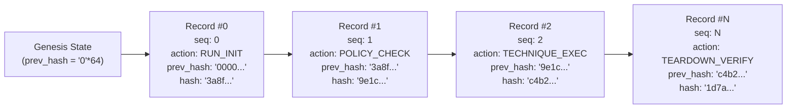

# Falcon Strike-AI — Tamper-Evident Hash-Chained Audit Integrity Specification

**Document Version:** 1.0.0  
**Date:** 2026-11-01  
**Target Requirements:** NFR-A1, NFR-A2, NFR-A3, NFR-A4  
**Status:** IMPLEMENTED & VERIFIED  

---

## 1. Overview & Security Objective

In an autonomous adversary emulation platform, provable auditability is a primary safety requirement. Security teams, SOC auditors, and compliance officers must have uncompromised visibility into every simulated adversary step, authorization token, configuration parameter, and teardown event.

Falcon Strike-AI implements an append-only, cryptographic **Hash-Chained Audit Logger** (`backend/app/core/audit.py`) and an independent **Audit Chain Verifier** (`backend/app/core/audit_verifier.py`). 

### Core Guarantees:
1. **Cryptographic SHA-256 Linkage**: Every audit record contains the cryptographic hash of the immediate preceding record, forming an unbroken Merkle-like chain from a deterministic genesis state (`"0" * 64`).
2. **Deterministic Canonical Serialization**: Record hashing uses RFC-8785-compliant canonical JSON formatting (strictly sorted keys, uniform timestamp formats, no non-deterministic whitespace).
3. **Automated Secret Scrubbing**: All record payloads pass through recursive redaction filters before hashing and serialization, preventing credentials, API tokens, and private keys from entering the audit trail.
4. **Independent Cryptographic Verification**: An independent verifier parses the audit ledger to detect and localize content modifications, record deletions, record insertions, and sequence reorderings.
5. **Thread-Safe Concurrency**: Atomic sequence increments and thread synchronization (`threading.RLock`) guarantee zero race conditions or chain forks during concurrent executions.

---

## 2. Hash Chain Architecture & Data Model

Defined in `backend/app/core/audit_models.py`:



### 2.1 Audit Record Schema (`AuditRecord`)

```json
{
  "sequence_id": 4,
  "record_id": "aud_018f4a7c89b271d4e001",
  "run_id": "run_sim_8f912c70",
  "timestamp": "2026-11-01T16:30:00.123456Z",
  "event_type": "EMULATION_EXECUTION",
  "action": "EXECUTE_TECHNIQUE",
  "actor": "falcon-strike-core",
  "details": {
    "technique_id": "T1087.004",
    "technique_name": "Cloud Account Discovery",
    "target": "arn:aws:iam::123456789012:role/ReadOnlyAuditRole",
    "dry_run": true,
    "indicators_emulated": ["canary_T1087_004_probe"]
  },
  "previous_hash": "3a8f4c2e...",
  "record_hash": "9e1c5b8a..."
}
```

### Field Definitions:
- `sequence_id` (int): Strictly monotonic, 0-indexed integer. Must increment by exactly 1 per block.
- `record_id` (str): Unique identifier with prefix `aud_`.
- `run_id` (str): Single correlation Run ID binding all events in an emulation lifecycle (NFR-A3).
- `timestamp` (str): RFC-3339 UTC timestamp with microsecond resolution.
- `event_type` (str): Categorical classification (e.g. `SYSTEM_EVENT`, `PLANNING`, `POLICY_EVALUATION`, `EMULATION_EXECUTION`, `TEARDOWN`, `CORRELATION`).
- `action` (str): Specific operation performed (e.g. `POLICY_GATE_APPROVED`, `SIMULATION_STEP_COMPLETED`).
- `actor` (str): Identity triggering the operation (e.g. `falcon-strike-agent`, `operator-cli`, `system`).
- `details` (dict): Context-specific parameters and operational outcomes (scrubbed of sensitive secrets).
- `previous_hash` (str): 64-character lowercase hexadecimal SHA-256 hash of the immediate prior record (or `"0" * 64` for sequence 0).
- `record_hash` (str): 64-character lowercase hexadecimal SHA-256 hash computed over the canonical serialization of this record.

---

## 3. Cryptographic Hashing & Canonical Serialization

To guarantee that hash computation is perfectly reproducible across different operating systems, Python versions, and architectures, the record is serialized using canonical conventions:

### Canonical Digest Computation
```python
def compute_hash(record: AuditRecord) -> str:
    # 1. Construct canonical dictionary (excluding record_hash itself)
    payload = {
        "sequence_id": record.sequence_id,
        "record_id": record.record_id,
        "run_id": record.run_id,
        "timestamp": record.timestamp,
        "event_type": record.event_type,
        "action": record.action,
        "actor": record.actor,
        "details": record.details,
        "previous_hash": record.previous_hash,
    }
    # 2. Canonical JSON string (sorted keys, compact separators, UTF-8)
    canonical_json = json.dumps(
        payload,
        sort_keys=True,
        separators=(",", ":"),
        ensure_ascii=False
    ).encode("utf-8")
    
    # 3. SHA-256 cryptographic digest
    return hashlib.sha256(canonical_json).hexdigest()
```

---

## 4. Automated Secret Scrubbing

Prior to hash computation and persistence, all payloads undergo recursive dictionary and list traversal to scrub confidential material:

```python
SENSITIVE_KEYS = {
    "password", "secret", "token", "jwt", "authorization", 
    "private_key", "api_key", "access_key", "secret_key", 
    "credential", "session_token"
}
REDACTION_MASK = "[REDACTED_SECRET]"
```

Any key matching these patterns (exact or substring boundary) has its value replaced with `[REDACTED_SECRET]`. This guarantees that even if an operator passes an API token in plan parameters, it will never be leaked into persistent audit logs.

---

## 5. Audit Chain Verifier (`AuditChainVerifier`)

Implemented in `backend/app/core/audit_verifier.py`:

The verification engine performs exhaustive linear validation over any audit file or in-memory list:

```mermaid
flowchart TD
    Start["Read Audit Record at index i"] --> CheckSeq["Verify Sequence ID == i"]
    CheckSeq -->|Fail| ErrSeq["Record Error: Sequence Break"]
    CheckSeq -->|Pass| CheckPrev["Verify record[i].previous_hash == record[i-1].record_hash"]
    CheckPrev -->|Fail| ErrPrev["Record Error: Broken Hash Chain"]
    CheckPrev -->|Pass| CheckHash["Recompute Canonical SHA-256 hash"]
    CheckHash -->|Hash != record[i].record_hash| ErrHash["Record Error: Content Tampered"]
    CheckHash -->|Pass| NextRecord{"More Records?"}
    NextRecord -->|Yes| Start
    NextRecord -->|No| Summary["Return AuditChainVerificationResult"]
```

### Detection Capabilities:
1. **Tampered Content Detection**: If an attacker modifies any field (e.g. changing an IP, technique ID, or target ARN), the recomputed hash diverges from `record_hash`.
2. **Record Deletion Detection**: If record #3 is deleted from a 10-record chain, record #4's `previous_hash` points to record #3's hash rather than record #2's hash, and sequence #4 expects sequence #3. Both errors are flagged immediately.
3. **Record Insertion Detection**: If a rogue record is inserted between #2 and #3, sequence numbers and forward hashes break.
4. **Reordering Detection**: Reversing or shuffling records breaks monotonic sequence checks and previous-hash pointers.

### Verification Result Model (`AuditChainVerificationResult`)
- `is_valid` (bool): True only if 100% of checks pass with zero discrepancies.
- `total_records` (int): Number of records verified.
- `genesis_hash` (str): Hash of the first record in the chain.
- `latest_hash` (str): Hash of the most recent record in the chain.
- `discrepancies` (list[str]): Detailed human-readable descriptions of any integrity failures.

---

## 6. Threat Model & Security Boundaries

| Threat Scenario | Mitigation in Falcon Strike-AI | Boundary / Limitation |
| :--- | :--- | :--- |
| **Log Injection / Tampering by Application** | Hash chain recalculation fails; verifier flags discrepancy | Application cannot tamper without breaking chain |
| **Accidental Secret Leakage** | Automated recursive redaction filter runs before hashing | Does not scrub unstructured secrets embedded inside raw prose strings |
| **Race Conditions / Concurrent Emulations** | Re-entrant locks (`RLock`) and dedicated per-run files | Process crashes midway leave an unclosed chain (still valid up to crash) |
| **Host Root / Malicious Sysadmin Adversary** | Hash chaining detects record modifications | A root user with write access could theoretically rewrite the entire file from genesis and recalculate all hashes |

> [!IMPORTANT]
> **Production Hardening Recommendation (WORM Storage)**:
> In enterprise deployments, `artifacts/audit/` logs should be streamed to an append-only, Write Once Read Many (WORM) storage target, such as **AWS S3 Object Lock in Compliance Mode** or **Google Cloud Storage Bucket Retention Policy**. Once committed to WORM storage, not even cloud root administrators can rewrite the hash-chained history.

---

## 7. Storage & Artifact Pathing

Audit logs are written to:
`artifacts/audit/audit_{run_id}.jsonl`

Each line contains a complete, valid JSON object representing one `AuditRecord`. This allows high-speed streaming line-by-line verification without loading gigabytes of log data into memory.

---

## 8. Verification & Automated Test Coverage

Tested in `backend/tests/test_audit.py`:
- `test_hash_chain_genesis_validity`: Validates block 0 genesis previous hash `"0"*64`.
- `test_hash_chain_continuation`: Confirms sequence monotonicity and SHA-256 linkages.
- `test_tampered_content_detected`: Confirms verifier flags modified fields.
- `test_deleted_record_detected`: Confirms verifier flags removed records.
- `test_reordered_records_detected`: Confirms verifier flags swapped records.
- `test_secret_scrubbing`: Confirms sensitive keys (`password`, `token`, etc.) are redacted before hashing.
- `test_thread_safe_concurrency`: Confirms zero race conditions under 10 concurrent threads.

