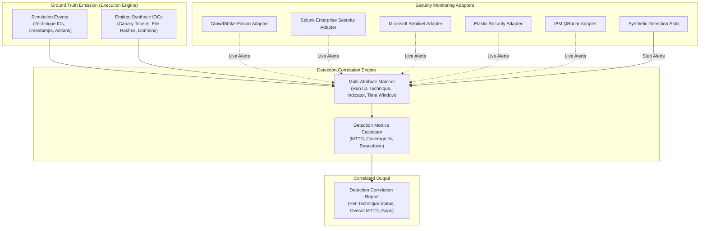

# Falcon Strike-AI — Detection Correlation Engine Specification

**Document Version:** 1.0.0  
**Date:** 2026-11-01  
**Target Requirement:** FR-5.1, NFR-A3  
**Status:** IMPLEMENTED & VERIFIED  

---

## 1. Overview & Objective

The **Detection Correlation Engine** (`backend/app/detection/`) bridges the gap between simulated adversary actions and enterprise defensive observability. During emulation, Falcon Strike-AI emits ground-truth telemetry and deterministic synthetic Indicators of Compromise (IOCs). The detection subsystem ingests these ground-truth artifacts, queries security monitoring platforms (SIEM, EDR, XDR, or an offline synthetic detection stub), and computes quantitative defensive metrics including **Mean Time to Detect (MTTD)**, **Detection Coverage**, and **Miss Rates**.

### Core Guarantees:
1. **Strict Provenance & Honesty**: If SIEM API credentials are not supplied, SIEM adapters honestly report `is_connected() == False` and refuse to fabricate connections. Offline environments use a clearly labeled `DETECTION_STUB` provider with transparent simulation profiles.
2. **Deterministic Correlation Matching**: Detections are correlated against ground truth through multi-attribute matching (run ID, campaign ID, technique ID, exact indicator tokens, artifact URIs, and temporal observation windows).
3. **Rigorous MTTD Calculation**: MTTD is computed strictly from observed detection timestamps minus ground-truth emission timestamps. If zero detections occur for a technique, MTTD is explicitly `None` rather than fabricated.

---

## 2. Architectural Design



---

## 3. Data Models & Schemas

Defined in `backend/app/detection/models.py`:

### 3.1 Detection Status
```python
class DetectionStatus(str, Enum):
    DETECTED = "DETECTED"                  # Ground truth matched by one or more alerts
    PARTIALLY_DETECTED = "PARTIALLY_DETECTED"  # Partial indicators detected (e.g. 1 of 2 IOCs)
    MISSED = "MISSED"                      # Emulated technique produced zero matching alerts
```

### 3.2 Security Detection Event
Represents an alert ingested from an external SIEM or synthetic stub:
- `event_id`: Unique alert ID.
- `detection_source`: Type of telemetry source (`EDR`, `SIEM`, `CLOUDTRAIL`, `DNS_ANALYTICS`, `DETECTION_STUB`).
- `timestamp`: RFC-3339 timestamp when the defensive alert triggered.
- `rule_name`: Name or ID of the detection rule (e.g. `Suspicious CloudTrail GetCallerIdentity`).
- `severity`: Alert severity (`INFO`, `LOW`, `MEDIUM`, `HIGH`, `CRITICAL`).
- `technique_id`: MITRE ATT&CK ID tagged by the SIEM (if mapped).
- `matched_indicators`: List of specific IOC tokens or attributes identified.
- `raw_alert`: Complete raw alert payload for deep forensic inspection.

### 3.3 Correlated Technique Result
The synthesized evaluation for a single executed technique:
- `technique_id`: ATT&CK technique ID (e.g. `T1087.004`).
- `status`: `DETECTED`, `PARTIALLY_DETECTED`, or `MISSED`.
- `first_emulated_at`: UTC timestamp of the earliest ground-truth action.
- `first_detected_at`: UTC timestamp of the earliest matched defensive alert.
- `detection_latency_seconds`: Calculated delta $(\text{first\_detected\_at} - \text{first\_emulated\_at})$.
- `matched_events`: List of all `SecurityDetectionEvent` objects tied to this technique.
- `ioc_coverage_ratio`: Ratio of ground-truth IOCs detected over total emitted (e.g., $1.0 = 100\%$).

### 3.4 Detection Correlation Report
The root aggregation for an entire campaign run:
- `run_id`: Single correlation Run ID binding the campaign.
- `campaign_id`: ID of the planned campaign.
- `total_techniques`: Number of techniques executed.
- `detected_count`: Count of fully detected techniques.
- `partially_detected_count`: Count of partially detected techniques.
- `missed_count`: Count of missed techniques.
- `coverage_percentage`: Calculated coverage score:
  $$\text{Coverage} = \frac{\text{detected} + 0.5 \times \text{partially\_detected}}{\text{total}} \times 100$$
- `mean_time_to_detect_seconds`: Average latency across all detected techniques (or `None` if zero detections).
- `technique_results`: List of `CorrelatedTechniqueResult` details.
- `unmatched_detections`: List of ingested alerts that could not be matched to any ground-truth action (potential false positives or ambient noise).

---

## 4. SIEM & EDR Adapters

Defined in `backend/app/detection/adapters.py`:

All adapters inherit from `BaseSIEMAdapter` (`backend/app/detection/interfaces.py`).

| Adapter | Target System | Connection Logic | Fallback Behavior |
| :--- | :--- | :--- | :--- |
| `CrowdStrikeFalconAdapter` | CrowdStrike Falcon XDR | Ingests OAuth2 Client ID/Secret | Raises `FalconSecurityException` when unconfigured |
| `SplunkAdapter` | Splunk Enterprise Security | Validates REST API endpoint & HEC token | Disconnected by default |
| `SentinelAdapter` | Microsoft Sentinel (Azure) | Validates Tenant, Client ID & Secret | Disconnected by default |
| `ElasticSecurityAdapter` | Elastic Security (ELK) | Validates Cloud ID / Elasticsearch URL & API Key | Disconnected by default |
| `QRadarAdapter` | IBM QRadar SIEM | Validates Host & SEC token | Disconnected by default |

### Connection Integrity Check
Every adapter implements `is_connected() -> bool`. If live credentials or host connectivity fail, the adapter returns `False` and logs a warning. The system never claims live SIEM telemetry when running disconnected.

---

## 5. Synthetic Detection Stub

Defined in `backend/app/detection/detection_stub.py`:

For air-gapped labs, local testing, and offline CI/CD pipelines, the `DetectionStub` generates realistic synthetic alerts grounded directly in the campaign's executed techniques and emitted IOCs.

### Simulation Profiles:
1. **`FULL_COVERAGE`**:
   - Detection probability = $1.0$ (100% of techniques detected).
   - Deterministic synthetic detection delay: $1.0\text{s} \le \Delta t \le 5.0\text{s}$.
   - All emitted IOC tokens are mapped into alerts.
2. **`PARTIAL_COVERAGE`**:
   - Detection probability = $0.7$ (70% detection chance per technique).
   - Emits partial IOC matches (subsets of emitted tokens).
   - Realistic delay: $5.0\text{s} \le \Delta t \le 30.0\text{s}$.
3. **`HIGH_MISS_RATE`**:
   - Detection probability = $0.3$ (30% detection chance; 70% evasion).
   - Long detection delay: $30.0\text{s} \le \Delta t \le 120.0\text{s}$.

All synthetic alerts are tagged with `detection_source="DETECTION_STUB"` and include the `run_id` in their metadata.

---

## 6. Correlation Algorithm & Matching Rules

Implemented in `backend/app/detection/correlation.py`:

```
Algorithm: CorrelateEvents(run_id, ground_truth_events, emitted_iocs, alert_stream)
1. Filter alert_stream for alerts referencing run_id or temporal window [start_time - 60s, end_time + 300s]
2. For each unique technique T executed in ground_truth_events:
     a. T_events = {e in ground_truth_events where e.technique_id == T}
     b. T_iocs = {i in emitted_iocs where i.technique_id == T}
     c. Find matching alerts in alert_stream where:
          - alert.technique_id == T OR
          - alert.matched_indicators intersects T_iocs.token_values OR
          - alert.rule_name matches T.description
     d. If matching alerts is empty:
          Status = MISSED
          Latency = None
     e. If matching alerts cover all T_iocs:
          Status = DETECTED
          Latency = min(alerts.timestamp) - min(T_events.timestamp)
     f. Else:
          Status = PARTIALLY_DETECTED
          Latency = min(alerts.timestamp) - min(T_events.timestamp)
3. Compute overall MTTD = average(all non-None Latencies)
4. Compute Coverage % = (detected + 0.5 * partially_detected) / total * 100
5. Isolate unmatched alerts as noise/unattributed
6. Return DetectionCorrelationReport
```

---

## 7. Metrics Calculation & Formulas

Implemented in `backend/app/detection/metrics.py`:

### 7.1 Mean Time to Detect (MTTD)
$$\text{MTTD} = \frac{1}{N_{\text{detected}}} \sum_{i=1}^{N_{\text{detected}}} \Delta t_i$$
Where $\Delta t_i = t_{\text{first\_alert}, i} - t_{\text{action\_start}, i}$.
- If $N_{\text{detected}} = 0$, $\text{MTTD} = \text{None}$ (explicitly reported as unavailable, never zero).

### 7.2 Detection Coverage Percentage
$$\text{Coverage} = \left(\frac{N_{\text{detected}} + (0.5 \times N_{\text{partially\_detected}})}{N_{\text{total}}}\right) \times 100$$

### 7.3 Miss Rate
$$\text{Miss Rate} = \left(\frac{N_{\text{missed}}}{N_{\text{total}}}\right) \times 100$$

---

## 8. API Endpoints

Mounted in `backend/app/api/v1/detection.py`:

| Method | Endpoint | Description | Request Body / Params |
| :--- | :--- | :--- | :--- |
| `POST` | `/api/v1/detection/correlate` | Execute correlation for a completed run | `{ "run_id": "...", "profile": "FULL_COVERAGE" }` |
| `GET` | `/api/v1/detection/reports/{run_id}` | Retrieve stored correlation report | Path param: `run_id` |

---

## 9. Verification & Automated Test Coverage

Tested in `backend/tests/test_detection.py`:
- `test_detection_stub_full_coverage`: Verifies 100% detection rate and valid MTTD under `FULL_COVERAGE`.
- `test_detection_stub_partial_coverage`: Verifies partial detection rate and IOC subsets.
- `test_detection_stub_high_miss_rate`: Verifies significant miss rates under stealth profile.
- `test_siem_adapter_disconnected_safety`: Confirms unconfigured adapters report disconnected and refuse live queries.
- `test_mttd_calculation_precision`: Validates floating-point precision of MTTD math.
- `test_mttd_none_when_all_missed`: Confirms MTTD returns `None` when zero detections exist.
- `test_multi_attribute_ioc_matching`: Confirms correlation on exact canary tokens and file hashes.
- `test_run_isolation_enforcement`: Confirms alerts from different `run_id` are ignored and never cross-pollute.

