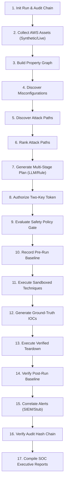

# Falcon Strike-AI — Operator End-to-End Runbook

**Document Version:** 1.0.0  
**Date:** 2026-11-01  
**Project:** Falcon Strike-AI  
**Audience:** Security Engineers, Red Teams, SOC Analysts, System Evaluators  
**Classification:** Strictly Authorized Lab Use Only  

---

## 1. Overview & Operational Lifecycle

Falcon Strike-AI executes an autonomous 17-stage Continuous Threat Exposure Management (CTEM) pipeline. This runbook provides clear, step-by-step instructions for running the complete workflow via CLI and REST API, verifying cryptographic audit chains, inspecting SOC reports, and handling emergency kill switches.

### The 17-Stage End-to-End Pipeline


---

## 2. Environment Setup & Configuration

### 2.1 Verify Prerequisites
Ensure Python 3.11+ is installed and virtual environment is active:
```bash
python --version
```

### 2.2 Configure Environment Variables
Copy and inspect the baseline configuration:
```bash
cp .env.example .env
```

Ensure safety parameters are set to default values:
```ini
FALCON_ENVIRONMENT=development
FALCON_DRY_RUN=true
FALCON_ALLOWLISTED_ACCOUNTS=123456789012,987654321098
FALCON_BLAST_RADIUS_MAX_RESOURCES=5
FALCON_BLAST_RADIUS_TIMEOUT_SECONDS=600
```

---

## 3. CLI Execution

The primary entry point for automated execution is the CLI `run` subcommand.

### 3.1 Standard Offline Dry-Run (Recommended for Evaluation)
Runs the full 17-stage pipeline against synthetic cloud topology in pure dry-run mode:
```bash
python -m backend.app.main run --mode synthetic --dry-run
```

**Expected Console Output:**
```
================================================================================
   FALCON STRIKE-AI: END-TO-END PIPELINE EXECUTION
================================================================================
[INFO] Run ID: run_sim_a1b2c3d4
[INFO] Mode: synthetic | Dry-Run: True
[STAGE 1/17] Initializing Audit Logger & Run Context...
[STAGE 2/17] Ingesting Cloud Environment Assets (Synthetic)...
[STAGE 3/17] Normalizing Environment Property Graph...
[STAGE 4/17] Detecting Cloud Misconfigurations...
[STAGE 5/17] Discovering Multi-Hop Attack Paths...
[STAGE 6/17] Ranking Attack Paths by Risk & Exploitability...
[STAGE 7/17] Formulating Agentic Campaign Plan...
[STAGE 8/17] Generating Two-Key Cryptographic Authorization Token...
[STAGE 9/17] Evaluating Plan Against Safety Policy Gate...
[STAGE 10/17] Recording Pre-Execution Environment Baseline...
[STAGE 11/17] Executing Sandboxed ATT&CK Techniques (Dry-Run: True)...
[STAGE 12/17] Emulating C2 Telemetry & Registering Ground-Truth IOCs...
[STAGE 13/17] Executing Idempotent Teardown Engine...
[STAGE 14/17] Verifying Environment Teardown Against Pre-Run Baseline...
[STAGE 15/17] Correlating Ground Truth Against Security Detections...
[STAGE 16/17] Verifying Hash-Chained Audit Trail Integrity...
[STAGE 17/17] Compiling Multi-Format SOC Executive Reports...
================================================================================
   PIPELINE EXECUTION SUMMARY: SUCCESS (Completed in 11.66 ms)
================================================================================
  - Total Stages: 17 | Completed: 17 | Failed: 0
  - Attack Paths Found: 1 | Top Risk Score: 85.0/100
  - Emulated Techniques: 3 | Ground-Truth IOCs Emulated: 6
  - Teardown Status: VERIFIED CLEAN (Discrepancies: 0)
  - Defensive Coverage: 100.0% | Mean Time to Detect (MTTD): 1.50s
  - Audit Chain Integrity: VALID (18 records cryptographically verified)
  - Report Artifacts:
      * artifacts/reports/report_run_sim_a1b2c3d4.json
      * artifacts/reports/report_run_sim_a1b2c3d4.md
      * artifacts/reports/report_run_sim_a1b2c3d4.html
```

---

## 4. REST API Execution & Inspection

The FastAPI control plane exposes full pipeline controls over HTTP.

### 4.1 Start the Control Plane Server
```bash
python -m uvicorn backend.app.main:app --host 127.0.0.1 --port 8000
```

### 4.2 Health & Status Checks
```bash
curl -s http://127.0.0.1:8000/health
```

### 4.3 Trigger Workflow via REST
```bash
curl -X POST http://127.0.0.1:8000/api/v1/workflow/run \
  -H "Content-Type: application/json" \
  -d '{
    "mode": "synthetic",
    "dry_run": true,
    "max_steps": 5,
    "detection_profile": "FULL_COVERAGE"
  }'
```

### 4.4 Inspect Audit Chain Integrity
```bash
curl -X POST http://127.0.0.1:8000/api/v1/audit/verify/run_sim_a1b2c3d4
```

### 4.5 Retrieve SOC Executive Report
```bash
# Retrieve JSON Report
curl -s http://127.0.0.1:8000/api/v1/reporting/run_sim_a1b2c3d4

# Export HTML Dashboard
curl -s "http://127.0.0.1:8000/api/v1/reporting/run_sim_a1b2c3d4/export?format=html" -o report.html
```

---

## 5. Inspecting Generated Artifacts

Following any CLI or API run, inspect the generated artifacts on disk:

### 5.1 Audit Trail (`artifacts/audit/audit_{run_id}.jsonl`)
Verify that every entry contains:
- Strict monotonic `sequence_id`.
- Valid `previous_hash` linking to the prior record's `record_hash`.
- Secret fields redacted to `[REDACTED_SECRET]`.

To run the verifier directly:
```bash
python -c "
from backend.app.core.audit import HashChainedAuditLogger
from backend.app.core.audit_verifier import AuditChainVerifier
logger = HashChainedAuditLogger(run_id='run_sim_a1b2c3d4')
result = AuditChainVerifier.verify_chain(logger.get_chain())
print('Chain Valid:', result.is_valid, 'Records:', result.total_records)
"
```

### 5.2 SOC Reports (`artifacts/reports/`)
- Open `artifacts/reports/report_{run_id}.html` in any web browser to view the executive dashboard, ATT&CK coverage heatmap, and prioritized remediation matrix.
- View `report_{run_id}.md` in VS Code or GitHub for plain markdown rendering.

---

## 6. Emergency Kill Switch Procedure

If an operator identifies anomalous behavior, an out-of-scope asset interaction, or requires an immediate abort:

### 6.1 Engaging Kill Switch via API
```bash
curl -X POST http://127.0.0.1:8000/api/v1/system/kill-switch \
  -H "Content-Type: application/json" \
  -d '{
    "reason": "Operator manual emergency stop requested during exercise",
    "operator_id": "operator-lead-01"
  }'
```

### 6.2 Engaging Kill Switch Programmatically
```python
from backend.app.orchestrator.kill_switch import EmergencyKillSwitch

EmergencyKillSwitch.engage(
    reason="Immediate exercise termination", 
    triggered_by="operator-cli"
)
```

### 6.3 Recovery & Reset
To re-enable operations after root-cause analysis:
```python
EmergencyKillSwitch.disengage()
```

---

## 7. Operational Troubleshooting

| Symptom | Probable Cause | Corrective Action |
| :--- | :--- | :--- |
| `PolicyGateRejection` with `AccountNotAllowlisted` | Target account is not in `FALCON_ALLOWLISTED_ACCOUNTS` | Add account ID to allowlist in `.env` or use synthetic lab account `123456789012` |
| `PolicyGateRejection` with `TwoKeyAuthorizationRequired` | Live mode requested without valid JWT token | Supply valid signed authorization token signed by two distinct authorized leads |
| `AuditVerificationError` with broken hash | Audit log file was manually modified or truncated | Re-run verification to pinpoint discrepancy line; do not manually edit `.jsonl` files |
| `DockerDaemonUnavailable` warning | Docker is not running on host machine | System safely defaults to `InMemorySimulatorRunner` with honest provenance logging |

