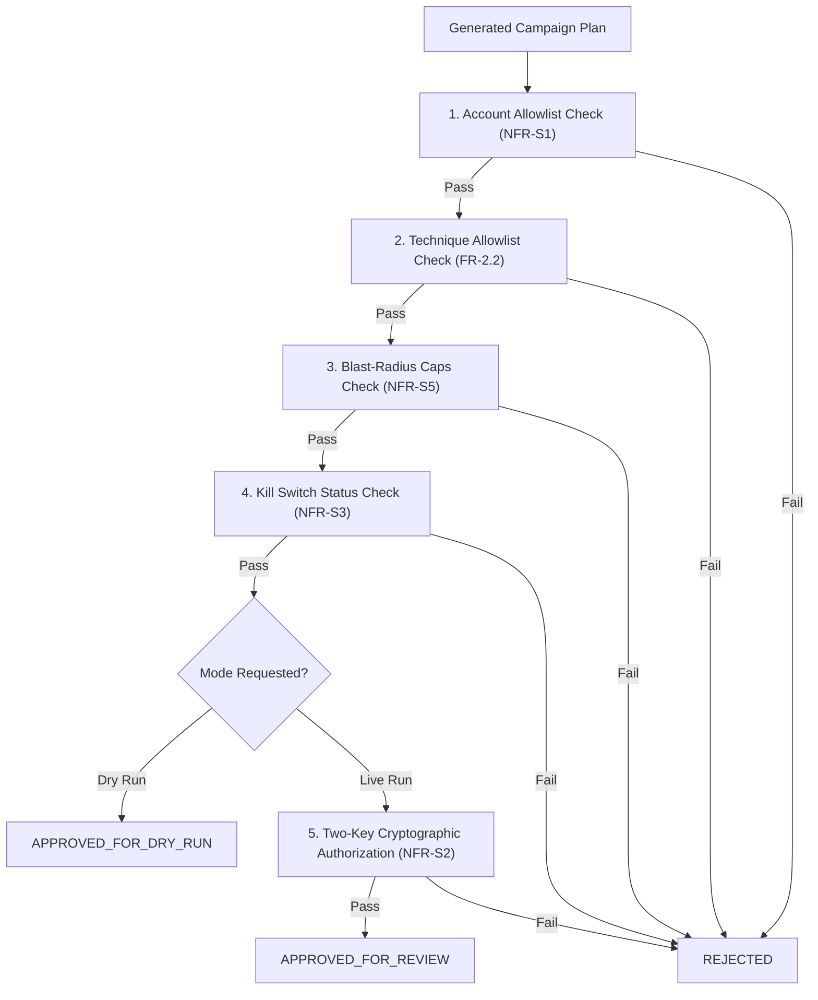

# Falcon Strike-AI — Safety Policy Gate Specification

**Document Version:** 1.0.0  
**Date:** 2026-11-01  
**Project:** Falcon Strike-AI  
**Conformance:** PRD Section 4.3, 7.1 (FR-2.5, NFR-S1, NFR-S2, NFR-S3, NFR-S5)  

---

## 1. Overview & Architectural Role

The **Safety Policy Gate** is an independent, non-bypassable control layer that wraps the orchestration pipeline. The AI agent (LLM planner) plans as data only; no campaign plan may be executed in dry-run or live mode without passing every mandatory policy rule evaluated by the `PolicyGateEngine`.

---

## 2. Mandatory Policy Rules & Invariants

### 2.1 Rule 1: Account Allowlist Check (`ACCOUNT_ALLOWLIST_CHECK`)
- **Invariant:** The target AWS Account ID must exist in `settings.allowlisted_accounts` or the compiled fallback tuple.
- **Enforcement:** Fails closed if account ID is unknown or out-of-scope (`HTTP 403`).

### 2.2 Rule 2: Technique Allowlist Check (`TECHNIQUE_ALLOWLIST_CHECK`)
- **Invariant:** Every technique ID in `plan.stages` must exist in `technique_registry`.
- **Enforcement:** Rejects any campaign containing unrecognized technique IDs or arbitrary commands.

### 2.3 Rule 3: Blast-Radius Caps Check (`BLAST_RADIUS_CAPS_CHECK`)
- **Limits Enforced:**
  - `MAX_CAMPAIGN_STAGES`: $\le 10$ stages.
  - `MAX_TARGET_RESOURCES`: $\le 5$ distinct resources.
  - `MAX_DURATION`: $\le 300$ seconds.
- **Enforcement:** Rejects any oversized plan exceeding configured limits.

### 2.4 Rule 4: Kill Switch Status Check (`KILL_SWITCH_STATUS_CHECK`)
- **Invariant:** If the emergency kill switch is engaged, all policy approvals are blocked immediately.

### 2.5 Rule 5: Two-Key Cryptographic Authorization (`TWO_KEY_AUTHORIZATION_CHECK`)
- **Invariant for Live Operations:** Exiting dry-run mode requires two distinct, unexpired HMAC/RSA signed JWT tokens:
  1. Primary Operator token (e.g. `sub: Engineer-Alice`, role: `RedTeamEngineer`).
  2. Secondary Approver token (e.g. `sub: Mentor-Bob`, role: `LeadSecurityMentor`).
- **Identity Separation:** The policy gate strictly verifies that `operator_id != secondary_approver_id`. The same person cannot satisfy both keys.

---

## 3. Policy Verdicts (`PolicyDecisionType`)

1. **`APPROVED_FOR_DRY_RUN`:** All safety rules satisfied for safe in-memory simulation. Dry-run touches zero live cloud resources.
2. **`APPROVED_FOR_REVIEW`:** All safety rules and two-key cryptographic tokens confirmed. Live execution gate is armed pending mentor review.
3. **`REJECTED`:** One or more rules violated. Execution is strictly blocked.

