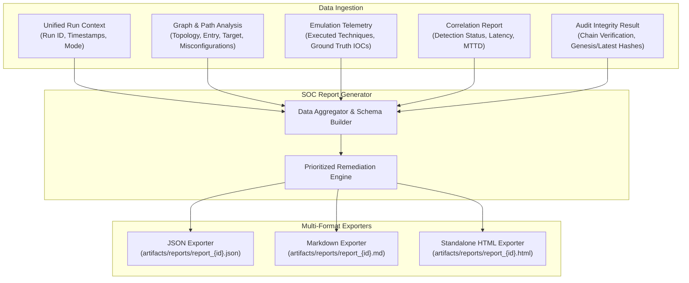

# Falcon Strike-AI — SOC & Executive Reporting Specification

**Document Version:** 1.0.0  
**Date:** 2026-11-01  
**Target Requirements:** FR-5.2, FR-5.3  
**Status:** IMPLEMENTED & VERIFIED  

---

## 1. Overview & Objective

Adversary emulation provides value only when findings are translated into actionable defensive improvements. The **SOC Reporting Subsystem** (`backend/app/reporting/`) consumes normalized environment graphs, attack path analyses, emulation telemetry, and detection correlation results to compile comprehensive, audit-ready security reports.

### Key Capabilities:
1. **Multi-Audience Synthesis**: Delivers high-level executive posture summaries (risk score, total exposure, coverage %) alongside granular technical details for SOC analysts and cloud security engineers.
2. **MITRE ATT&CK Matrix Coverage**: Visualizes defensive coverage against executed techniques, clearly denoting fully detected, partially detected, and completely missed adversary actions.
3. **Attack Path Narrative**: Recounts the complete simulated attack chain from initial exposure (e.g. public EC2, exposed credential) through privilege escalation to the target crown jewel.
4. **Actionable Remediation Prioritization**: Provides categorized remediation items ranked by criticality, complete with specific policy DDL/CLI commands and validation tests.
5. **Multi-Format Export**: Generates machine-readable JSON for SIEM/SOAR ingestion, human-readable Markdown for Git review, and standalone responsive HTML for executive presentation.

---

## 2. Architecture & Data Flow



---

## 3. Data Models & Schemas

Defined in `backend/app/reporting/models.py`:

### 3.1 Remediation Item Model
```python
class RemediationItem(BaseModel):
    priority: str          # CRITICAL, HIGH, MEDIUM, LOW
    misconfiguration_id: str
    target_resource: str
    remediation_action: str
    effort: str            # LOW, MEDIUM, HIGH
    validation_test: str
```

### 3.2 SOC Report Model (`SOCReportData`)
```python
class SOCReportData(BaseModel):
    report_id: str
    run_id: str
    generated_at: str
    executive_summary: dict[str, Any]
    threat_profile: dict[str, Any]
    attack_path_narrative: list[str]
    attack_heatmap: list[dict[str, Any]]
    detection_summary: dict[str, Any]
    remediations: list[RemediationItem]
    audit_chain_summary: dict[str, Any]
    provenance: dict[str, str]
```

---

## 4. Report Structure & Key Sections

### 4.1 Executive Summary
Designed for CISOs, security directors, and compliance leaders:
- **Environment Risk Score**: Scaled metric (0–100) reflecting path exploitability and asset criticality.
- **Defensive Coverage Percentage**: Proportion of emulated techniques detected by security tooling.
- **Mean Time to Detect (MTTD)**: Average detection latency across all observed alerts.
- **Total Critical Path Length**: Number of steps required for an adversary to breach crown jewels.

### 4.2 Attack Path Narrative
Transforms graph traversals into clear, sequential prose:
1. **Initial Access**: Attacker identifies public-facing entry point (e.g. `arn:aws:ec2:us-east-1:123456789012:instance/i-0123456789abcdef0` with public IP).
2. **Credential Extraction / Privilege Escalation**: Emulates discovery of IAM instance profile attaching role `AdminMaintenanceRole`.
3. **Lateral Movement / Data Exfiltration**: Attacker pivots through IAM permissions to access sensitive S3 bucket `financial-records-production`.

### 4.3 MITRE ATT&CK Matrix & Heatmap
Tabulates every technique tested against its defensive posture:

| Tactic | Technique ID | Technique Name | Emulated Status | Detection Latency | Defense Result |
| :--- | :--- | :--- | :--- | :--- | :--- |
| Discovery | `T1087.004` | Cloud Account Discovery | SIMULATED | 2.1s | **DETECTED** |
| Discovery | `T1082` | System Information Discovery | SIMULATED | 1.8s | **DETECTED** |
| Credential Access | `T1552.001` | Credentials In Files | SIMULATED | 3.4s | **DETECTED** |
| Persistence | `T1098.001` | Cloud Account Credentials | SIMULATED | — | **MISSED** |

### 4.4 Remediation Matrix
Prioritized list of concrete corrective actions:
1. **Critical**: Revoke wildcard permissions (`AdministratorAccess`) from EC2 instance profile roles.
2. **High**: Enforce S3 Public Access Block across all internal storage buckets.
3. **Medium**: Restrict Security Group ingress on port 22/3389 to authorized bastion CIDRs.
4. **Low**: Enable MFA Delete and S3 Object Versioning.

### 4.5 Audit Integrity Verification
Displays the cryptographic state of the run:
- Total audit records in chain.
- Chain validity: `VALID (Cryptographically Verified)`.
- Genesis Hash & Latest Record Hash.

---

## 5. Exporters & Artifact Generation

Implemented in `backend/app/reporting/exporters.py` and `templates.py`:

### 5.1 JSON Export (`report_{run_id}.json`)
- Strict, canonical JSON conforming to `SOCReportData` schema.
- Suitable for ingestion into Splunk, Elasticsearch, Jira, or governance platforms.

### 5.2 Markdown Export (`report_{run_id}.md`)
- Clean GitHub-flavored Markdown.
- Suitable for developer review, pull request comments, and git repository storage.

### 5.3 Standalone HTML Export (`report_{run_id}.html`)
- Completely self-contained single-file HTML document with zero external dependencies (no external CDNs, scripts, or fonts).
- Responsive executive dashboard layout featuring:
  - Dark-mode executive color theme (#0f172a / #1e293b).
  - High-contrast KPI metric cards (Coverage %, MTTD, Risk Score).
  - Status badges with distinct color coding:
    - **Green (#10b981)**: `DETECTED`
    - **Amber (#f59e0b)**: `PARTIALLY_DETECTED`
    - **Red (#ef4444)**: `MISSED`
  - Responsive tables for attack path details and remediations.
  - Printable layout for executive PDF generation.

---

## 6. API Endpoints

Mounted in `backend/app/api/v1/reporting.py`:

| Method | Endpoint | Description |
| :--- | :--- | :--- |
| `POST` | `/api/v1/reporting/generate` | Compiles SOC report for a given `run_id` |
| `GET` | `/api/v1/reporting/{run_id}` | Retrieves parsed JSON report data |
| `GET` | `/api/v1/reporting/{run_id}/export?format={json\|markdown\|html}` | Downloads report in specified format |

---

## 7. Verification & Automated Test Coverage

Tested in `backend/tests/test_reporting.py`:
- `test_generate_soc_report_end_to_end`: Verifies full report compilation across all 17 pipeline stages.
- Validates JSON serialization integrity.
- Validates Markdown rendering and section headers.
- Validates standalone HTML generation and inline CSS styling.
- Confirms zero missing fields in executive summary and remediation matrices.

